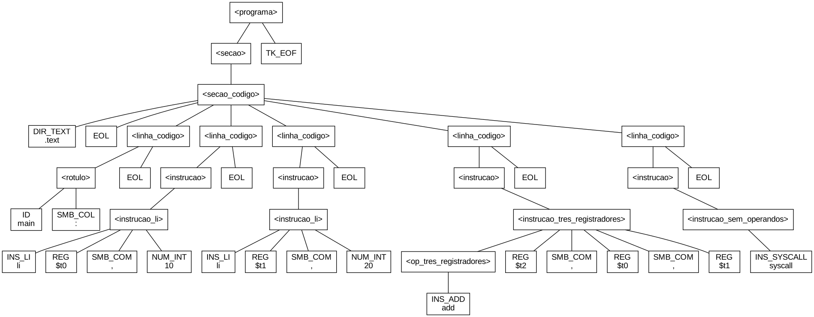

# Relatório técnico — Análise Sintática (Assembly MIPS)

Linguagens Formais, Autômatos e Compiladores — UCB, 2º semestre de 2026
Prof. Marcelo Eustáquio

## 1. Compilação e execução

```sh
gcc main.c preprocessador.c lexico.c sintatico.c -o main.exe
./main.exe <arquivo_entrada.asm> <prefixo_saida>
# exemplo
./main.exe teste.asm resultado
dot -Tpng resultado.dot -o resultado.png    # renderização da árvore (Graphviz)
```

Arquivos produzidos: `resultado.pre`, `resultado.lex`, `resultado.ts`, `resultado.lex.err`,
`resultado.sin.err` e `resultado.dot`. Todos são recriados a cada execução.

| Código de saída | Situação |
|---|---|
| 0 | Execução concluída e programa sintaticamente válido |
| 1 | Rejeição por erros léxicos ou sintáticos |
| 2 | Falha operacional ou uso incorreto da linha de comando |

Todos os casos de teste podem ser executados com `sh testes/executar_testes.sh`.

## 2. Organização modular

| Arquivo | Responsabilidade |
|---|---|
| `main.c` | Valida os argumentos, abre/fecha todos os arquivos, coordena as três etapas e define o código de saída |
| `preprocessador.c/.h` | Etapa 1 — remove comentários e linhas vazias, normaliza espaços |
| `lexico.c/.h` | Etapa 2 — AFD que gera `.lex`, `.ts` e `.lex.err` |
| `sintatico.c/.h` | Etapa 3 — analisador descendente recursivo, `.sin.err` e `.dot` |

Interface da etapa 3 (em `sintatico.h`):

```c
int AnaliseSintatica(FILE *tokens, FILE *arvore, FILE *erros); /* 0 válido, 1 inválido, -1 falha */
```

**Integração com o léxico.** As interfaces públicas anteriores foram mantidas. Foi acrescentada a
função `int QuantidadeErrosLexicos(void)` em `lexico.h`, que expõe o estado do módulo após
`AnaliseLexica()`. Se ela retornar um valor maior que zero, `main()` não executa a análise
sintática, imprime `ANÁLISE SINTÁTICA NÃO EXECUTADA: EXISTEM ERROS LÉXICOS.`, grava a mesma
mensagem no `.sin.err` e deixa o `.dot` vazio. Antes de cada etapa, o arquivo de entrada
(`.pre` e `.lex`, abertos em modo `wb+`) é reposicionado no início com `rewind()`.

## 3. Estruturas de dados

- **Token** — reaproveita a estrutura `Token` de `lexico.h` (`nome` = categoria, `lexema`,
  `linha`, `coluna`). Os tokens do `.lex` são carregados em um vetor dinâmico
  (`g_tokens`) antes do reconhecimento, e `g_pos` aponta o token corrente (lookahead de 1).
- **NoArvore** — nós da árvore sintática concreta guardados em um vetor dinâmico (`g_nos`) e
  ligados por índice: `primeiroFilho`, `ultimoFilho` e `proximoIrmao`. Isso preserva a ordem
  dos filhos, permite anexar filhos em O(1) e libera toda a árvore com um único `free`.
  Cada nó guarda o rótulo (`<nao_terminal>` ou categoria do terminal), o lexema e um
  indicador de terminal.
- **Conjuntos de decisão** — vetores constantes de categorias (`SECOES`, `DIRETIVAS_DADOS`,
  `OP_TRES_REG`, `OP_MEMORIA`, ...) usados pelas funções para escolher a alternativa pelo
  próximo token.

**Leitura do `.lex`.** Cada linha tem o formato `<CATEGORIA, lexema> linha coluna`. A
categoria termina na primeira ocorrência de `", "` (categorias não têm vírgulas), e linha e
coluna são os dois últimos campos. Assim, lexemas de `STRING` que contêm vírgulas, espaços,
`>` ou aspas escapadas são preservados integralmente. Linha mal formada resulta em falha
operacional (retorno -1).

## 4. Correspondência entre não terminais e funções

A técnica é a descendente recursiva: há uma função por não terminal, e cada uma retorna 1
quando a construção foi reconhecida ou 0 quando houve erro sintático.

| Não terminal | Função | Decisão / observação |
|---|---|---|
| `<programa>` | `programa()` | repete `<secao>` enquanto o próximo token for `.data`/`.text`; consome `TK_EOF` |
| `<secao>` | `secao()` | `DIR_DATA` → dados; `DIR_TEXT` → código |
| `<secao_dados>` | `secao_dados()` | `.data EOL` + `{<linha_dados>}` até nova seção ou `TK_EOF` |
| `<secao_codigo>` | `secao_codigo()` | `.text EOL` + `{<linha_codigo>}` até nova seção ou `TK_EOF` |
| `<linha_dados>` | `linha_dados()` | `ID` → rótulo [+ diretiva]; diretiva de dados; `.globl` |
| `<linha_codigo>` | `linha_codigo()` | `ID` → rótulo [+ instrução]; instrução; `.globl` |
| `<rotulo>` | `rotulo()` | `ID ":"` |
| `<diretiva_global>` | `diretiva_global()` | `".globl" ID` |
| `<diretiva_dados>` | `diretiva_dados()` | `.word/.half/.byte`, `.ascii/.asciiz`, `.space`, `.align` |
| `<diretiva_inteiros>` | `diretiva_inteiros()` | `.word` \| `.half` \| `.byte` |
| `<lista_inteiros>` | `lista_inteiros()` | `NUM_INT {"," NUM_INT}` (laço `while`) |
| `<diretiva_string>` | `diretiva_string()` | `.ascii` \| `.asciiz` |
| `<instrucao>` | `instrucao()` | escolhe um dos 11 grupos pela categoria do operador |
| `<instrucao_tres_registradores>` | `instrucao_tres_registradores()` | `op REG , REG , REG` |
| `<op_tres_registradores>` | `op_tres_registradores()` | add, addu, sub, subu, mul, and, or, xor, nor, slt |
| `<instrucao_dois_registradores>` | `instrucao_dois_registradores()` | `op REG , REG` |
| `<op_dois_registradores>` | `op_dois_registradores()` | move, div |
| `<instrucao_um_registrador>` | `instrucao_um_registrador()` | `op REG` |
| `<op_um_registrador>` | `op_um_registrador()` | mflo, mfhi, jr |
| `<instrucao_imediato>` | `instrucao_imediato()` | `addi REG , REG , NUM_INT` |
| `<instrucao_deslocamento>` | `instrucao_deslocamento()` | `op REG , REG , NUM_INT` |
| `<op_deslocamento>` | `op_deslocamento()` | sll, srl |
| `<instrucao_li>` | `instrucao_li()` | `li REG , NUM_INT` |
| `<instrucao_la>` | `instrucao_la()` | `la REG , ID` |
| `<instrucao_memoria>` | `instrucao_memoria()` | `op REG , <endereco>` |
| `<op_memoria>` | `op_memoria()` | lw, sw, lb, sb, lh, sh |
| `<endereco>` | `endereco()` | `ID` \| `NUM_INT "(" REG ")"` |
| `<instrucao_desvio>` | `instrucao_desvio()` | `op REG , REG , ID` |
| `<op_desvio>` | `op_desvio()` | beq, bne, blt, ble, bgt, bge |
| `<instrucao_salto>` | `instrucao_salto()` | `op ID` |
| `<op_salto>` | `op_salto()` | j, jal |
| `<instrucao_sem_operandos>` | `instrucao_sem_operandos()` | syscall, nop |

As funções `op_*` usam um auxiliar comum, `operador()`, que cria o nó `<op_...>` e consome o
terminal se ele pertencer ao conjunto. Os terminais esperados são consumidos por
`esperar(pai, categoria, descricao)`, que anexa a folha à árvore ou registra o erro.

## 5. Tratamento de EOL e TK_EOF

- Ao carregar os tokens, um `EOL` é inserido **após o último token de cada linha** que contém
  tokens, ou seja, quando o próximo token está em outra linha ou quando ele é o último antes
  do fim. A última linha recebe `EOL` mesmo sem quebra de linha final. Como o
  pré-processador já remove linhas vazias e comentários, essas linhas não geram marcadores.
  A coluna do `EOL` é a posição imediatamente posterior ao último lexema da linha.
- O `.lex` não é alterado: os marcadores existem apenas na memória do analisador.
- Se o `.lex` contém `TK_EOF`, ele é usado (e nada depois dele é lido). Se não contém,
  `TK_EOF` é acrescentado internamente, nunca duplicado.
- `avancar()` nunca passa de `TK_EOF`, e `programa()` termina consumindo `TK_EOF` como folha
  da raiz. Isso garante o consumo integral da entrada.

## 6. Diagnóstico e recuperação de erros

Formato de cada diagnóstico no `.sin.err`:

```
Linha L, coluna C: Encontrado CATEGORIA("lexema"); esperado ELEMENTO.
```

Quando o elemento ausente está no final da linha, o token encontrado é o `EOL`
(`Encontrado o término da linha (EOL)`), com a coluna logo após o último lexema. No final do
arquivo, o diagnóstico informa `Encontrado TK_EOF`. Em erros de seção, a mensagem explica o
motivo: instrução em `.data`, diretiva de dados em `.text` ou conteúdo antes da primeira seção.

**Linha e coluna** são as posições do arquivo `.pre`, as mesmas usadas pelo léxico. O `.pre`
não tem comentários, linhas vazias nem espaços iniciais, o que corresponde ao exemplo do
enunciado ("linha sem espaços iniciais").

**Recuperação (modo pânico por linha).** Quando uma função de linha (`linha_dados`,
`linha_codigo`, a abertura de seção ou o conteúdo antes da primeira seção) recebe 0 de
alguma função interna, chama `recuperar()`. Essa função descarta os tokens até o `EOL` e
consome o `EOL`. Se o token corrente já for o `EOL`, consome só ele; se for `TK_EOF`, não
consome nada. Ela nunca descarta tokens de linhas posteriores, e a seção ativa é preservada.
Como os laços de seção param ao encontrar `.data`/`.text`, a mudança de seção é reconhecida
normalmente na linha seguinte. Cada chamada avança pelo menos até o fim da linha, então não
há repetição do mesmo diagnóstico. É registrado no máximo um erro por linha, e as linhas
seguintes continuam sendo analisadas. Qualquer erro torna o programa inválido.

O arquivo vazio, ou composto só de comentários, chega como `[TK_EOF]` e é rejeitado por não
ter a seção exigida por `<programa>`.

**Fora do escopo sintático.** Rótulos inexistentes, rótulos duplicados, limites numéricos,
deslocamentos inválidos em `sll/srl`, valores de `.space/.align` e códigos de `syscall` não
geram erro sintático. Os testes `valido1` e `valido3` exercitam esses casos.

## 7. Construção da árvore sintática concreta

Cada função de não terminal cria o seu nó (`<nome>`) como filho do nó recebido e anexa os
filhos na ordem da produção. As repetições da EBNF viram filhos sucessivos, e as partes
opcionais ausentes não criam nós. Cada terminal consumido vira uma folha com a categoria e o
lexema, incluindo `SMB_COM`, `SMB_COL`, `SMB_OPA`, `SMB_CPA`, `EOL` e `TK_EOF`.

Na geração do DOT, os nós são numerados em pré-ordem (`n0` = `<programa>`), e as arestas são
emitidas pai → filho, na ordem dos filhos. Nos rótulos, `"` e `\` são escapados, e `\n`
separa a categoria do lexema. A árvore só é gravada quando não há erro. Nos programas
inválidos, o `.dot` fica vazio e nenhuma árvore parcial é produzida.

Para o programa de exemplo do enunciado (`testes/valido0_exemplo_enunciado.asm`), o `.dot`
gerado é **idêntico** ao apresentado na especificação.



## 8. Casos de teste

Entradas em `testes/*.asm`; saídas completas em `testes/saidas/`
(`.pre`, `.lex`, `.ts`, `.lex.err`, `.sin.err`, `.dot`, e `.png` para os válidos).

| Caso | Cobertura | Esperado | Obtido |
|---|---|---|---|
| `valido0_exemplo_enunciado` | exemplo da especificação | válido (0) | válido (0) |
| `valido1_organizacao` | início direto por `.text`; alternância; seção `.data` vazia; `.globl` nas duas seções; rótulo isolado e rótulo + instrução; linhas vazias e comentários; arquivo **sem quebra de linha final**; referência a rótulo inexistente | válido (0) | válido (0) |
| `valido2_diretivas` | todas as diretivas (`.word .half .byte .ascii .asciiz .space .align .globl`); listas; decimais, negativos e hexadecimais; strings com vírgula, `>`, `#` e escapes; rótulo + diretiva e rótulo isolado em `.data` | válido (0) | válido (0) |
| `valido3_instrucoes` | todos os grupos e todas as 36 operações; endereço por ID e por `desloc(REG)`; rótulo duplicado; deslocamento fora da faixa | válido (0) | válido (0) |
| `invalido1_estrutura` | operandos ausentes, excedentes, fora de ordem e de categoria inadequada; vírgula ausente; tokens após construção completa; recuperação | inválido (1) | inválido (1) |
| `invalido2_pontuacao_secoes` | lista terminada por vírgula; dois-pontos, vírgula e parênteses ausentes; instrução em `.data`; diretiva de dados em `.text`; lixo após `.data`; recuperação e troca de seção | inválido (1) | inválido (1) |
| `invalido3_sem_secao` | programa sem abertura de seção | inválido (1) | inválido (1) |
| `invalido4_vazio` | arquivo vazio | inválido (1) | inválido (1) |
| `invalido5_so_comentarios` | apenas comentários e linhas vazias | inválido (1) | inválido (1) |
| `lexico_com_erro` | erro léxico → sintática não executada | rejeitado (1) | rejeitado (1) |

### Diagnósticos obtidos

`invalido1_estrutura.sin.err`
```
Linha 4, coluna 9: Encontrado REG("$t1"); esperado SMB_COM(",").
Linha 5, coluna 13: Encontrado o término da linha (EOL); esperado SMB_COM(",").
Linha 6, coluna 9: Encontrado ID("mensagem"); esperado NUM_INT.
Linha 7, coluna 9: Encontrado REG("$t0"); esperado EOL (término da linha).
Linha 8, coluna 14: Encontrado SMB_COM(","); esperado EOL (término da linha).
Linha 9, coluna 11: Encontrado NUM_INT("5"); esperado REG.
Linha 10, coluna 4: Encontrado NUM_INT("10"); esperado REG.
Linha 11, coluna 3: Encontrado REG("$ra"); esperado ID.
Linha 12, coluna 13: Encontrado o término da linha (EOL); esperado SMB_COM(",").
Linha 13, coluna 9: Encontrado NUM_INT("4"); esperado ID.
```

`invalido2_pontuacao_secoes.sin.err`
```
Linha 2, coluna 17: Encontrado o término da linha (EOL); esperado NUM_INT.
Linha 3, coluna 16: Encontrado NUM_INT("2"); esperado EOL (término da linha).
Linha 4, coluna 1: Encontrado INS_LI("li"); esperado rótulo, diretiva de dados ou .globl (instruções só são admitidas na seção .text).
Linha 5, coluna 8: Encontrado INS_LI("li"); esperado SMB_COL(":").
Linha 6, coluna 4: Encontrado INS_ADD("add"); esperado diretiva de dados ou EOL (instruções só são admitidas na seção .text).
Linha 8, coluna 11: Encontrado REG("$sp"); esperado SMB_OPA("(").
Linha 9, coluna 14: Encontrado o término da linha (EOL); esperado SMB_CPA(")").
Linha 10, coluna 8: Encontrado NUM_INT("0"); esperado SMB_COM(",").
Linha 11, coluna 6: Encontrado INS_ADDI("addi"); esperado SMB_COL(":").
Linha 12, coluna 1: Encontrado DIR_WORD(".word"); esperado rótulo, instrução ou .globl (diretivas de dados só são admitidas na seção .data).
Linha 13, coluna 7: Encontrado DIR_SPACE(".space"); esperado instrução ou EOL (diretivas de dados só são admitidas na seção .data).
Linha 14, coluna 1: Encontrado DIR_ASCIIZ(".asciiz"); esperado rótulo, instrução ou .globl (diretivas de dados só são admitidas na seção .data).
Linha 15, coluna 7: Encontrado NUM_INT("5"); esperado EOL (término da linha).
```

As linhas válidas posteriores aos erros (`li $t1, 1` no caso 1; `ok: .word 1`, `.text` e
`syscall` no caso 2) foram reconhecidas sem novos diagnósticos, o que confirma a recuperação.

`invalido3_sem_secao.sin.err`
```
Linha 1, coluna 1: Encontrado INS_LI("li"); esperado abertura de seção: DIR_DATA(".data") ou DIR_TEXT(".text").
Linha 2, coluna 1: Encontrado INS_ADD("add"); esperado abertura de seção: DIR_DATA(".data") ou DIR_TEXT(".text").
```

`invalido4_vazio.sin.err` e `invalido5_so_comentarios.sin.err`
```
Linha 1, coluna 1: Encontrado TK_EOF; esperado abertura de seção: DIR_DATA(".data") ou DIR_TEXT(".text").
```

`lexico_com_erro.sin.err`
```
ANÁLISE SINTÁTICA NÃO EXECUTADA: EXISTEM ERROS LÉXICOS.
```

Programas válidos: `.sin.err` = `Nenhum erro sintático encontrado.`. Os arquivos DOT estão em
`testes/saidas/valido*.dot`, e as imagens renderizadas pelo Graphviz em `testes/saidas/valido*.png`.

### Verificações adicionais

- Compilação sem avisos com `gcc -Wall -Wextra -pedantic -std=c99`.
- Execução de todos os casos com AddressSanitizer/UBSan, sem ocorrências.
- `.lex` sem `TK_EOF` explícito: o token é acrescentado internamente uma única vez.
- Uso incorreto da linha de comando e arquivo de entrada inexistente retornam o código 2.
